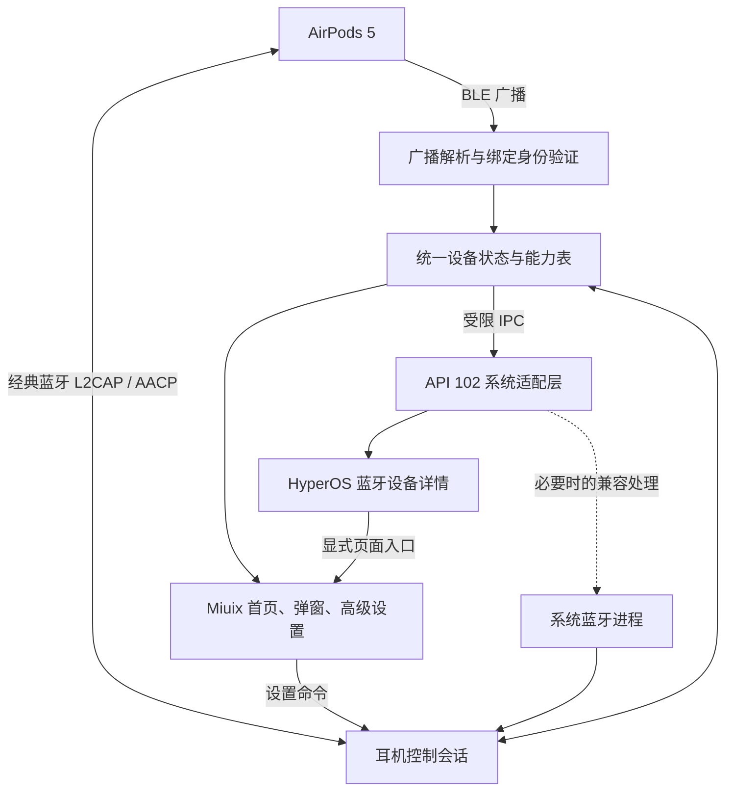

# HyperPods-X 开发方案书

**版本：v0.1 · 审阅稿 · 2026-10-22**

本方案以用户已确认的 **Xiaomi 17 Pro Max + HyperOS 4 + AirPods 5** 为唯一首批适配组合。应用名称为 **HyperPods-X**，`applicationId` 与 `namespace` 均为 **`com.hyper.podsrx`**，使用 **libxposed API 102**，界面以 **Miuix** 为基础。本轮交付为方案文档；尚未开始模块实现、安装或真机测试。

建议采用“**一个 APK，包含耳机管理 App 与现代 Xposed 模块**”的结构：App 承担通信、状态管理和设置界面，模块提供 HyperOS 蓝牙设置入口、电量展示适配及必要的蓝牙栈兼容处理。首版以四项核心需求完整闭环为目标，随后逐项补齐该副 AirPods 实际支持的高级设置。

## 1. 适配范围与需要真机确认的事实

| 项目 | 已确定的范围 | 真机接入后记录 |
| --- | --- | --- |
| 手机 | Xiaomi 17 Pro Max | 设备代号、CPU ABI、系统构建指纹 |
| 系统 | HyperOS 4 | 底层 Android/API 级别、完整构建号、安全补丁日期 |
| 系统组件 | 仅适配这台手机的组件版本 | 设置、蓝牙服务、小米蓝牙组件的包名、版本及 APK/库指纹 |
| 耳机 | 用户的 AirPods 5 | 型号编号、充电盒版本、固件、广播格式、可读写能力 |
| 模块框架 | 实际运行 API ≥ 102 的现代 Xposed 框架 | 框架名称、版本、API、系统进程与远程配置能力 |
| 使用范围 | 一台目标手机、一副已绑定耳机 | 首版不开展跨品牌、跨系统版本和多耳机管理适配 |

HyperOS 的版本名称不能代替 Android SDK 级别或蓝牙组件版本；具体 Hook 点以实机 APK 与运行结果为依据。设备需要具备能够运行上述模块框架的环境，是否已安装将在接机时检查。

Apple 当前区分两种 AirPods 5：普通版本的型号编号为 A3531/A3532/A3533，无线充电盒版本为 A3439/A3440/A3441。滑动音量等能力存在版本差异，因此连接后自动确认版本，再生成设置项。[Apple 型号识别][apple-models]、[Apple 按压与滑动设置][apple-controls]

## 2. 参考项目核对结果

| 来源 | 已核实的内容 | 对本项目的用法 |
| --- | --- | --- |
| LSPosed Wiki、libxposed/api | API 102 使用现代入口和 Hook 链；目标 API 102 的模块不能调用旧 `de.robv.android.xposed` 接口 | 新建 API 102 模块层，采用官方入口、生命周期与配置方式 |
| HyperPods `aap` 分支 | 有入耳检测、降噪、电量和小米系统集成；README 明确说明已移除 BLE 监听；源码使用旧版 YukiHookAPI/Xposed 接口 | 参考小米组件接入思路，重写 Hook；开盖检测单独实现 |
| LibrePods `main` 分支 | 包含 AACP/ATT、BLE、耳机控制、原生蓝牙修补等实现；所读 `module.prop` 的 min/target 仍为 101 | 移植经过审计的协议逻辑，并针对 API 102、AirPods 5 和本机 ROM 适配 |
| LibrePods 的 AirPods 5 支持 | `AirPods.kt` 已列出两种 AirPods 5；所读 `BLEManager.kt` 的广播型号表尚未列入这一代 | 型号定义可作为线索；广播 ID、字段布局、身份匹配与开盖行为必须实测，缺少映射不等于整个协议不可用 |
| Miuix | 提供 Compose UI、偏好设置等组件；README 标注接口仍可能变化 | 使用实际依赖构建界面，锁定发布版本并封装少量常用组件 |

上述是源码与文档核对结果，并非这些项目已在目标设备上通过测试的证明。研究依据：[现代 API 文档][modern-api]、[API 102 源码][api-interface]、[HyperPods README][hyperpods]、[HyperPods 模块入口][hp-entry]、[LibrePods 模块配置][lp-prop]、[型号能力定义][lp-models]、[BLE 实现][lp-ble]、[Miuix][miuix]。

## 3. 四项核心需求的实现方案

### 3.1 开盖弹窗

**用户体验：**首次完成系统配对及应用内绑定后，在手机附近打开充电盒，显示耳机名称、连接状态、左右耳与充电盒电量，并提供“耳机设置”入口。默认采用 Miuix 风格的底部浮层，支持自动收起、点击外部关闭以及弹窗开关。

实现链路：

1. 通过系统配对记录与 AACP 信息确认目标耳机；在耳机允许时取得用于识别随机地址、解析广播的 IRK/加密密钥。
2. BLE 过滤 Apple 厂商广播，使用绑定身份验证、型号及报文结构校验匹配目标设备。RSSI 只辅助判断距离，设备名称和临时 MAC 不作为唯一身份依据。
3. 将广播转换为“盒盖状态、电量、充电状态”等事件，经过去抖、过期处理与重复事件合并，形成一次开盖会话。
4. 首次看到已打开的盒盖也可触发一次；同一次开盖不因地址轮换或连接状态变化反复弹出。信号丢失记为状态未知，不直接当作真实关盖。
5. App 服务通过获授权的悬浮窗显示卡片。用户点击卡片后进入高级设置；锁屏默认使用轻提示，解锁后按设置展示，不主动唤醒屏幕。

**关键门槛：**需验证 AirPods 5 的广播身份与盒盖字段，以及 HyperOS 后台扫描行为。如果只能在经典蓝牙连接后提示，应明确标为“连接提示”，不能把它当作已经完成“未连接时开盖检测”。未获得可信绑定身份时，提供首次绑定引导，不对周围未知耳机自动弹窗。

扫描使用带过滤器的低功耗监听，短时间增强扫描只用于绑定、开盖确认或重连。根据实机结果选择过滤扫描回调/`PendingIntent` 与前台服务组合，避免常驻最高扫描档。Android 的 `neverForLocation` 会过滤部分 BLE 广播，是否影响本机 AirPods 广播需要实测。[LibrePods BLE 实现][lp-ble]、[Android 蓝牙权限][android-bt]

HyperOS 原生耳机弹窗样式作为后续优化项：确认 `com.xiaomi.bluetooth` 等组件在本机的实际接口后，再评估复用。首版自绘弹窗的外观、入口和数据来源固定，避免被私有动画资源或系统组件改版阻塞。

### 3.2 系统蓝牙设置中的高级设置入口

目标路径：**系统设置 → 蓝牙 → 此副 AirPods 的设备详情 →「HyperPods-X 高级设置」**。

模块在实际承载该详情页的进程中，对页面构建或更新方法进行 Hook，动态加入一条偏好设置项。先检查 `com.android.settings`，如果 HyperOS 4 将页面交给小米蓝牙组件，再适配实际承载方。入口仅出现在已绑定的目标设备详情页。

点击后通过显式 Intent 打开 App 内的 `DeviceSettingsActivity`，传递经过校验的本地设备标识，返回时回到系统蓝牙页面。高级设置使用完整 Miuix 页面，系统页面中的入口保持系统原有样式。API 102 已取消资源 Hook，因此采用运行时页面对象/控制器适配。[现代 API 文档][modern-api]

页面注入必须可重复执行而不产生重复条目；不在系统主线程扫描蓝牙、等待 IPC 或解析协议。找不到目标类、方法签名不匹配时停止该项注入并给出诊断，保留原有蓝牙设置操作。

### 3.3 左右耳与充电盒电量

首版覆盖 **App 首页、开盖弹窗、系统蓝牙设备详情** 三个位置，统一消费同一份状态。

| 数据源 | 使用策略 |
| --- | --- |
| AACP 已连接状态报告 | 优先使用有效的左右耳、盒体电量与充电状态 |
| 已验证并成功解密的 BLE 广播 | 补充未建立控制连接时的电量；精度以实际字段为准 |
| 普通 BLE 广播 | 可能只有粗粒度数据，显示“约 XX%”，不包装成精确 1% |
| 历史缓存 | 展示最后已知值并注明更新时间；从未取得的数据显示“—” |

每个部件分别记录数值、来源、时间、有效性与充电状态。充电盒合盖或休眠后可能不再报告，不能持续显示成实时数据；真实 0% 与未知值必须区分。只有验证了报告格式和分辨率，才承诺 1% 刻度显示。[LibrePods 电量解析][lp-packets]、[BLE 电量解析][lp-ble]

系统详情页优先显示“左耳 / 右耳 / 充电盒”摘要。若本机系统支持合适的蓝牙 metadata，则通过受限的系统桥接同步；否则采用详情页展示适配。状态栏、系统小部件和控制中心电量属于进一步集成，不作为首版三处显示的替代品。

### 3.4 尽量完整的高级设置

功能是否可用由 **实际型号 + 固件 + 已知协议 + 读取/写入回执 + 行为验证** 共同决定。首次连接先读取耳机现有设置，不用本地默认值覆盖。写入后显示处理中，收到设备状态回报或完成回读再确认；失败则恢复已确认值。重连后重新同步。

下表为开发目标清单，所有“首版”项目均须在目标真机上验证后才能标为支持。

| 设置项 | 计划 | 验证重点 |
| --- | --- | --- |
| 耳机名称、型号、固件、序列号信息 | 首版 | 区分手机蓝牙别名与耳机内部名称；系统名称缓存可能需重新连接或配对刷新 |
| 降噪 / 通透 / 自适应 / 关闭 | 首版 | 模式枚举与状态回报；“关闭模式”是否另有启用条件，以此固件为准 |
| 单耳降噪 | 首版 | 确认单耳佩戴时实际生效 |
| 自适应音频强度 | 首版 | 读取允许范围，映射滑块，不猜测枚举或强度单位 |
| 对话感知 | 首版 | 设备侧开关、说话时降低媒体音量、结束后的恢复；避免反复改动手机总音量 |
| 个性化音量 | 首版 | 开关与状态同步，长期自适应效果另作持续观察 |
| 自动入耳检测 | 首版 | 开关、左右耳状态；仅恢复由本模块暂停且仍适合恢复的媒体 |
| 左右耳长按动作、循环切换的聆听模式 | 首版 | 左右独立配置、允许的模式组合 |
| 麦克风：自动 / 左 / 右 | 首版 | 真正录音或通话验证，不能只检查开关外观 |
| 接听、挂断、静音/取消静音操作配置 | 首版 | 区分耳机配置与 Android 通话执行；先验收系统通话，第三方 VoIP 分别记录 |
| 连按速度、长按持续时间 | 首版 | 按压操作与回读对应 |
| 提示音音量 | 首版验证项 | 验证指令、可选范围与实际提示音 |
| 入睡后暂停 | 首版验证项 | 固件开关、事件是否送达 Android、媒体响应；实际睡眠触发需要用户长期验证 |
| 滑动音量开关、滑动所需幅度/时长 | 无线充电盒版本适用时纳入首版 | 先确认型号具备硬件能力，再验证协议参数 |
| 点头/摇头与操作映射 | 扩展验证 | 运动数据、事件与 Android 通话行为；按需订阅，控制耗电与误触 |
| 三段 EQ | 扩展验证 | 当前型号/固件是否支持；区分耳机内保存的 EQ 与手机端音效 |
| 相机遥控 | 扩展验证 | 先验证系统相机前台使用场景；手势与播放/长按动作的占用冲突 |
| 充电盒提示音开关 | 无线充电盒版本的扩展验证 | 硬件、协议与状态回读；参考项目存在命令不等于该功能已完成 |
| 优化电池充电、充电上限等充电策略 | 调研项 | 先核对该型号在 Apple 端实际提供的选项，再查明控制协议与保存位置 |
| 自动回连到这台手机 | 首版 | 系统连接策略配合有退避的重连，避免抢占通话或循环连接 |

设置清单依据 Apple 的[通用设置][apple-settings]、[聆听设置][apple-listening]、[按压与滑动设置][apple-controls]、[EQ 文档][apple-eq]，并参考 LibrePods 的[AACP 指令实现][lp-aacp]。Apple 端存在功能只说明产品能力，不能直接证明 Android 上已可实现。

**按当前单设备目标划定的边界：**Siri、Apple 账户/iCloud 自动切换、Apple“查找”网络、精确查找、Apple 音频共享、系统级实时翻译和固件 OTA，不列入首版交付。长按启动 Android 默认语音助手可以另行实现，但会明确其 Android 行为。动态头部追踪空间音频需要声音渲染与系统音频链路支持，能够接收头部姿态不代表已经实现空间音频。[LibrePods 功能边界][librepods]

助听器、听力测试、心率等不作为 AirPods 5 的设置直接复制；Apple 当前将相应听力健康和心率功能列在特定 Pro 型号下。手机端单声道、左右声道平衡等设置可提供对应系统入口，须标明其作用于手机音频。[Apple 用户指南][apple-settings]

## 4. 工程架构



建议按职责拆分以下 Gradle 模块，规模控制在单设备项目可以维护的程度：

| 模块 | 职责 |
| --- | --- |
| `:app` | Application、页面、前台服务、权限引导、弹窗与打包 |
| `:core:protocol` | AACP/ATT/BLE 编解码、报文校验；尽量保持纯 Kotlin，可离线回放测试 |
| `:core:device` | 唯一绑定身份、连接状态机、功能能力表、设置命令与电量合并 |
| `:core:ipc` | 跨进程接口与数据模型，隔离系统进程与 App 内部对象 |
| `:hook` | API 102 入口、系统设置、电量桥接、HyperOS 4 版本适配 |
| `:native` | 仅在实机确有需要时加入的 arm64 蓝牙栈兼容代码 |

App 中由一个设备服务拥有控制连接，页面只观察状态和发送类型化命令，避免多个页面抢占同一连接。BLE 用于发现和状态补充；控制通道使用经典蓝牙上的 L2CAP/AACP，不将 Android 的 LE L2CAP 接口当作可直接互换的实现。[LibrePods 连接代码][lp-connection]

连接状态区分：蓝牙关闭、已绑定未连接、音频已连接、控制握手中、控制可用、能力受限、恢复中。A2DP 音频已连接不等于 AACP 控制已连接。读写工作在 IO 线程，设置命令顺序执行、合并重复滑块写入，并使用有上限的超时与退避。

### API 102 构建约束

已核实的依赖坐标：[libxposed API][api]、[libxposed Service][api-service]。

```kotlin
compileOnly("io.github.libxposed:api:102.0.0")
implementation("io.github.libxposed:service:102.0.0")
```

入口继承 `XposedModule`，在框架生命周期回调内初始化。使用 `src/main/resources/META-INF/xposed/` 下的 `java_init.list`、`module.prop`、`scope.list`；启用 Native Hook 时再加入相应入口。模块配置建议：

```properties
minApiVersion=102
targetApiVersion=102
staticScope=true
autoHotReload=false
```

首版关闭自动热重载：系统蓝牙连接、原生 Hook 和跨进程回调的清理行为先以受控重启验证，后续再评估热重载。R8 按官方规则保留和适配模块入口。用户要求的 API 102 不应通过只改 `targetApiVersion` 来满足，旧 Xposed/Yuki 依赖与配置桥接必须逐一替换。[API 源码][api-interface]、[官方示例配置][api-example]

Miuix 使用 `miuix-ui` 与需要的 `miuix-preference`，图标按需引入。本次查询的最新非预发布 GitHub release 为 **v0.9.4**，建议作为起始验证版本；实施时核实对应 Maven 工件及兼容的 Kotlin、Compose、AGP、JDK 版本，再一起锁入版本目录。`main` README 展示的工具链不直接当作该 release 的工具链。[Miuix v0.9.4][miuix-release]

### Hook 范围与蓝牙栈处理

| 进程/包 | 首版策略 |
| --- | --- |
| 系统设置实际承载包，预计 `com.android.settings` | 核心：设备详情入口与电量展示 |
| 系统蓝牙实际包，预计 `com.android.bluetooth` | 按需：栈兼容与特权数据桥接 |
| `com.xiaomi.bluetooth` | 仅当实际设备详情或必需系统接口位于其中时启用 |
| `com.android.systemui` / 控制中心插件 | 后续原生卡片集成时再评估 |
| `android` / `system_server` | 首版设计不依赖该范围，实机发现必要性时再提出具体改动 |

LibrePods 文档指出，部分新系统已不需要旧蓝牙栈修补。因此先测试本机未经修补的控制通道，只有可复现地失败且原因匹配时才实施原生兼容处理。若需处理 `libbluetooth_jni.so` 等库，记录路径、Build ID、哈希与符号/特征，按版本精确匹配，不沿用其他 ROM 偏移。[LibrePods Android 说明][lp-android]、[原生实现参考][lp-native]

VendorID 模拟单独评估，默认关闭。它可能改变手机对其他蓝牙设备呈现的身份，不能声称天然只影响这副耳机；只有某个目标功能确实依赖它、影响范围已验证后，才列入可选实验能力。不能限制影响范围的原生改动不计为首版稳定能力。

配置采用 App 本地存储加 libxposed 远程偏好；实时状态通过 Binder/AIDL 等受限接口传递。对跨进程调用校验真实 UID、所属包、设备标识和命令参数。注入后的代码使用宿主进程身份，不能假设它拥有模块 APK 的签名权限。蓝牙身份密钥保存在 App 私有加密存储中，不写入系统展示数据或诊断日志。

## 5. Miuix 界面方案

整体使用系统字体、浅色/深色主题、圆角分组卡片、清晰的设置项与适量过渡动画。耳机图形使用自制或许可证明确的素材。普通界面围绕用户能执行的操作呈现，Hook 类名、原始报文与底层错误放在诊断页。

| 页面 | 内容与交互 |
| --- | --- |
| 首次设置 | 模块状态 → 附近设备权限 → 选择已配对 AirPods → 建立控制连接 → 弹窗/后台运行设置 |
| 首页 | 耳机名称与连接状态；左右耳/盒体三格电量；常用聆听模式；进入完整设置 |
| 高级设置 | 声音与聆听、按压与手势、佩戴与麦克风、通话与相机、充电盒、设备信息 |
| 开盖浮层 | 耳机图形、连接状态、三格电量、关闭与耳机设置按钮；大字和横屏可用 |
| 模块设置 | 弹窗、通知、后台行为、系统集成状态、主题；实验功能单独分组 |
| 诊断 | 框架 API、目标组件匹配情况、控制通道状态、数据更新时间、脱敏日志导出 |

单设备产品默认直接进入耳机首页。连接中显示连接进度，断开时显示明确的离线/历史状态；写入失败会恢复设置值并给出原因。硬件不支持的功能不生成开关；协议尚未确认的功能放在“待验证能力”说明中；实验功能默认关闭。

权限按功能解释：附近设备用于扫描/连接，通知用于连接状态，悬浮窗用于跨应用开盖卡片，后台运行配置用于持续监听。服务按实际 SDK 使用 `connectedDevice` 类型及对应权限，不能假设前台服务自动获得后台启动 Activity 的能力。[前台服务类型][android-fgs]、[后台界面启动规则][android-bal]

## 6. 实施顺序与阶段交付

| 阶段 | 工作 | 可审阅的交付与进入下一阶段的条件 |
| --- | --- | --- |
| M0：真机基线 | 只读检查系统/框架/组件；确定 AirPods 5 版本与固件；提取所需目标 APK/库供分析 | 设备基线表、确认后的 Hook 范围、协议验证清单 |
| M1：通信与 API 102 验证 | API 102 测试模块成功加载；建立控制通道；读取设备信息、电量、初始设置与可用身份密钥 | 最小验证 APK、成功/失败证据；若关键通道不通，先解决该依赖 |
| M2：电量与开盖 | 适配 AirPods 5 广播、身份匹配与状态机；实现首页、开盖弹窗和后台恢复 | 可实测的开盖、电量版本；验证未建立音频连接时的真实开盖触发 |
| M3：系统入口 | 定位并适配 HyperOS 蓝牙详情页，加入高级设置入口和电量摘要 | 从系统蓝牙页进入同一耳机设置，返回正常且不出现重复条目 |
| M4：高级设置 | 按清单实现读取、写入、回读与行为验证；加入适用的扩展项目 | 逐项能力矩阵，记录支持、未支持、失败原因与固件条件 |
| M5：稳定交付 | 回归、耗电对照、异常与恢复测试、构建及来源整理 | APK、完整源码、构建说明、安装/停用说明、实测报告与已知限制 |

先把 M1 的关键不确定性变成实测结果，再细化工期。额外 ROM 或其他耳机型号不占用这条首版交付路径。最终交付的“支持”仅指实际通过测试的目标系统构建与耳机固件组合；OTA 后重新校验适配指纹。

## 7. 真机测试与验收标准

以下是**拟定验收目标，不是已测结果**。用户提供 USB 调试连接后，先完成 M0；需要佩戴、开合盖、通话、拍照等人工动作时，给出明确操作步骤并同步记录时间点。

| 范围 | 验收方法与目标 |
| --- | --- |
| 开盖弹窗 | 在服务正常运行、已完成绑定、手机亮屏及 App 后台场景，各进行 30 次开合；目标每组至少 29 次成功、端到端延迟 P95 ≤ 2 秒；同次开盖只弹一次 |
| 锁屏与未连接 | 单独测试锁屏轻提示、解锁后恢复、已配对但无音频连接、长时间合盖后再开盖；报告各自的成功率与延迟，不用亮屏成绩代替 |
| 设备身份 | 验证随机地址轮换后仍识别同一副耳机；用混合广播回放及可获得的其他设备验证不误弹 |
| 电量 | 与有效协议报告逐项核对左右耳/盒体；覆盖充电、0%、未知、单耳、盒体休眠和旧缓存，所有展示位置一致 |
| 系统入口 | 连续进入/返回 30 次，覆盖断开、重连、旋转与设置进程重启；只显示一个目标入口，原有设置正常 |
| 高级设置 | 每项记录初始值、写入、设备回报/回读、实际行为、重连后的状态；对非持久化设置明确说明 |
| 音频与通话 | 连续播放至少 1 小时；覆盖摘戴耳机、单耳、来电和结束通话；无模块引入的明显断音或路由异常 |
| 稳定性 | 20 次蓝牙开关、至少 2 次重启、App 进程被回收后的恢复；系统设置和蓝牙进程无模块引起的崩溃/ANR |
| 后台耗电 | 相同条件下分别记录启用/停用模块的 8 小时待机结果，同时检查扫描、唤醒和 CPU；报告实测增量，不预设未经验证的续航承诺 |
| 故障恢复 | 拒绝权限、框架未激活、匹配失败、连接超时、Hook 开关关闭后均给出清晰状态；可停用模块恢复系统原路径 |

协议层使用真实脱敏报文回放验证短包、未知 opcode、分包/粘包、状态乱序、左右耳交换、未知电量和固件变化。测试目的为发现错误解析和状态错误；界面验收使用真实数据，演示数据不进入交付版本。

与安全相关的实施约束限定在实际设计需要：系统回调只做轻量处理；原生改动按构建指纹匹配；失败时跳过对应能力；保留 App 的系统集成总开关与框架停用路径。测试记录不包含 IRK、加密密钥或完整耳机序列号。

## 8. 代码复用与交付材料

建议在保留来源记录的前提下移植协议和系统适配思路。HyperPods README 标注 GPL v3，LibrePods 标注 GPL v3 或更新版本；若复用其代码，建议项目按 GPL-3.0 路线组织源码和发布材料，并保留逐文件版权、修改及来源说明。Miuix 为 Apache-2.0，保留其许可证及适用声明。[HyperPods][hyperpods]、[LibrePods][librepods]、[Miuix 许可证][miuix-license]

交付包括可安装 APK、完整 Gradle 工程、固定依赖版本与上游引用记录、功能矩阵、真机测试报告、安装/停用说明。签名配置与密钥另行妥善保存，不提交到源码。首版以本地功能为主，诊断日志由用户主动导出。

**本稿请重点审阅的产品决策：**单设备适配范围；开盖采用 Miuix 自绘浮层；系统蓝牙详情页跳转到 App 高级设置；核心设置与扩展验证项的划分；按实际型号和回读结果开放功能。AirPods 5 的充电盒版本、系统完整构建号与框架状态将在真机接入后核实，无需现在手动补齐。

[modern-api]: https://github.com/LSPosed/LSPosed/wiki/Develop-Xposed-Modules-Using-Modern-Xposed-API
[api]: https://github.com/libxposed/api/blob/master/README.md
[api-interface]: https://github.com/libxposed/api/blob/master/api/src/main/java/io/github/libxposed/api/XposedInterface.java
[api-service]: https://github.com/libxposed/service/blob/master/README.md
[api-example]: https://github.com/libxposed/example/blob/master/app/src/main/resources/META-INF/xposed/module.prop
[hyperpods]: https://github.com/Mo-SeTian/HyperPods/tree/aap
[hp-entry]: https://github.com/Mo-SeTian/HyperPods/blob/aap/app/src/main/java/moe/chenxy/hyperpods/hook/HookEntry.kt
[librepods]: https://github.com/librepods-org/librepods
[lp-android]: https://github.com/librepods-org/librepods/blob/main/android/README.md
[lp-prop]: https://github.com/librepods-org/librepods/blob/main/android/app/src/main/resources/META-INF/xposed/module.prop
[lp-models]: https://github.com/librepods-org/librepods/blob/main/android/app/src/main/java/me/kavishdevar/librepods/data/AirPods.kt
[lp-ble]: https://github.com/librepods-org/librepods/blob/main/android/app/src/main/java/me/kavishdevar/librepods/bluetooth/BLEManager.kt
[lp-packets]: https://github.com/librepods-org/librepods/blob/main/android/app/src/main/java/me/kavishdevar/librepods/data/Packets.kt
[lp-aacp]: https://github.com/librepods-org/librepods/blob/main/android/app/src/main/java/me/kavishdevar/librepods/bluetooth/AACPManager.kt
[lp-connection]: https://github.com/librepods-org/librepods/blob/main/android/app/src/main/java/me/kavishdevar/librepods/bluetooth/BluetoothConnectionManager.kt
[lp-native]: https://github.com/librepods-org/librepods/blob/main/android/app/src/main/cpp/l2c_fcr_hook.cpp
[miuix]: https://github.com/compose-miuix-ui/miuix
[miuix-release]: https://github.com/compose-miuix-ui/miuix/releases/tag/v0.9.4
[miuix-license]: https://github.com/compose-miuix-ui/miuix/blob/main/LICENSE
[apple-models]: https://support.apple.com/en-ie/109525
[apple-settings]: https://support.apple.com/en-in/guide/airpods/dev57e5b7e58/27/web/27
[apple-listening]: https://support.apple.com/en-in/guide/airpods/dev6d977ff21/27/web/27
[apple-controls]: https://support.apple.com/en-in/guide/airpods/dev68116dd52/27/web/27
[apple-eq]: https://support.apple.com/en-in/guide/airpods/te819024i19r/27/web/27
[android-bt]: https://developer.android.com/develop/connectivity/bluetooth/bt-permissions
[android-fgs]: https://developer.android.com/develop/background-work/services/fgs/service-types
[android-bal]: https://developer.android.com/guide/components/activities/secure-bal
