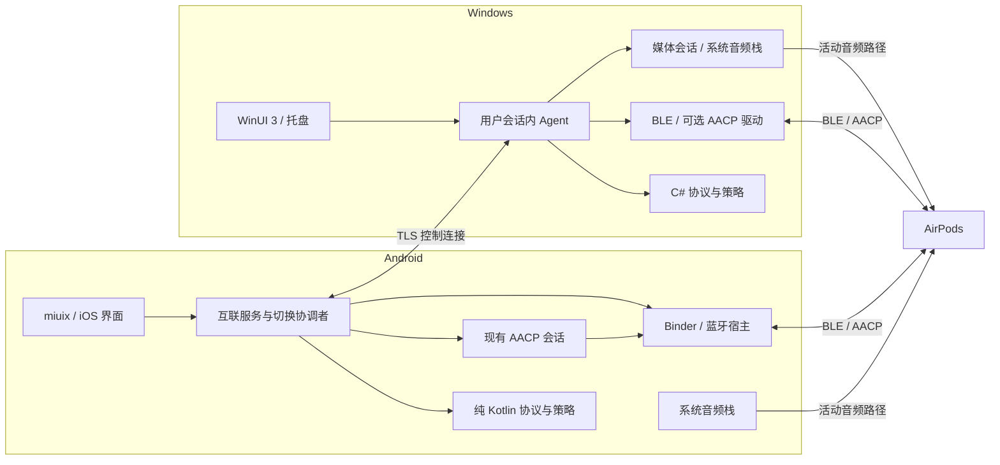
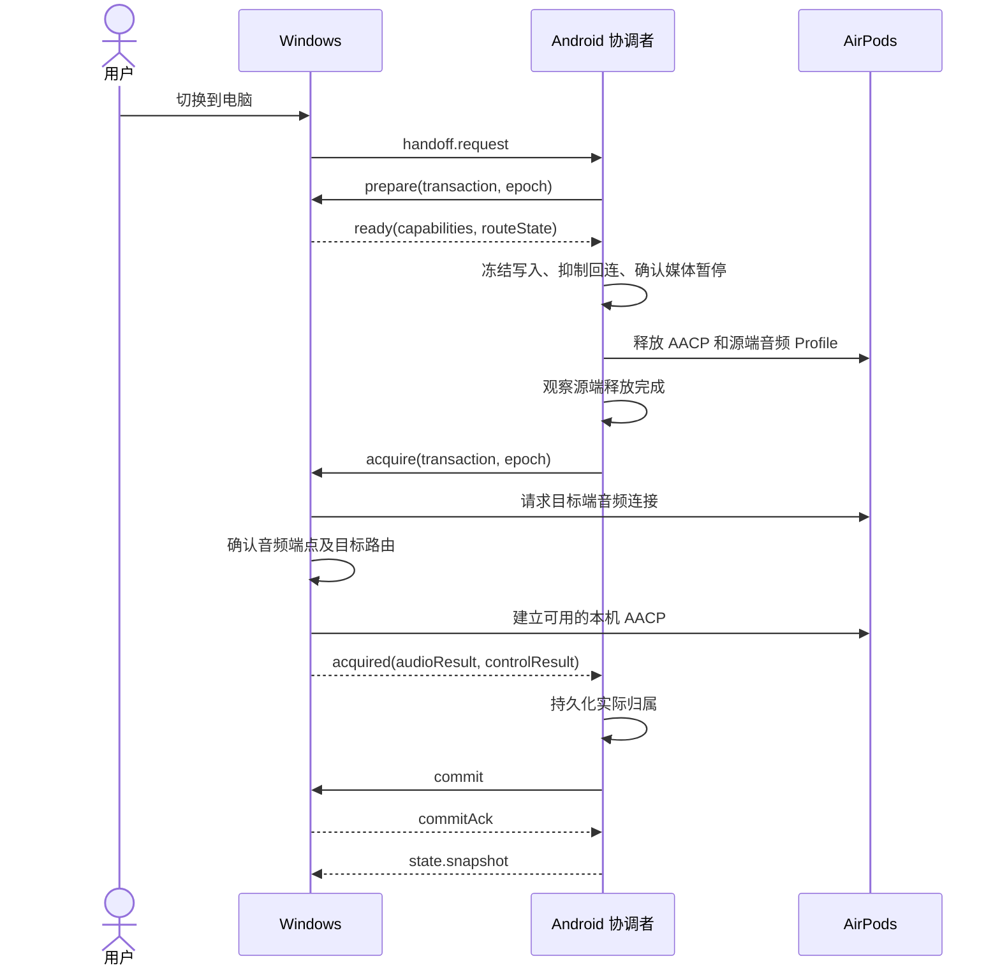

# HyperPods-X Windows 扩展与 Android 双设备互联设计

版本：v0.1 · 日期：2026-10-31 · 状态：设计草案，阶段 P0 待开展

目标版本：Windows 首个预览版与 Android 互联实验功能，应用版本号在 P0 后确定。

代码基线：`88ef378`，Android `0.5.1-dev`，`minSdk 36` / `targetSdk 37`

## 1. 方案决策

Windows 端采用独立桌面客户端，与 Android 通过局域网建立经过身份认证的控制连接。两端分别使用本机蓝牙和音频栈连接 AirPods，共享耳机状态、控制意图与切换事务。音频由当前播放设备直接发送到耳机。

实施分三层推进：

1. **伴随控制**：耳机连接 Android 时，在 Windows 查看电量、佩戴状态和聆听模式，经手机执行耳机设置。
2. **Windows 本机控制**：Windows 独立完成耳机识别、AACP 读写、托盘面板和本机媒体联动。
3. **双设备切换**：协调源端释放、目标端连接与音频路由确认，随后开放满足条件的自动切换。

Windows AACP 传输和两端音频连接控制是两项独立前置条件。P0 分别验证，伴随控制可以先交付；完整 Windows 耳机控制和自动切换按验证结果开放。

| 决策项 | 初步选择 | 原因 |
| --- | --- | --- |
| Windows 客户端 | C#、.NET 10 LTS、WinUI 3 | 接入 WinRT、Core Audio、托盘及桌面生命周期；按 Windows 交互方式设计 [W8][W9] |
| Windows 验证基线 | Windows 11 x64，P0 固定具体系统构建与蓝牙驱动版本 | 先缩小硬件和系统组合，ARM64 在驱动路径确定后评估 |
| 跨端连接 | 局域网 TCP + TLS 1.3，配对后双向身份认证 | 单一可靠连接承载低频状态与命令，便于限流、重连和诊断 |
| 发现与配对 | Windows 展示二维码，Android 扫码；mDNS 作为可选发现方式 | 首次连接可直接使用局域网地址，发现结果不承担身份认证 |
| 核心复用 | 保留 Kotlin 协议核心；Windows 按共同协议样本实现 C# 对应逻辑 | 避免先重写成熟 Android 工程，跨语言一致性由契约与测试约束 |
| 切换协调者 | 一个配对组内由 Android 协调，Windows 可发起请求 | 首版只支持一部手机、一台电脑、一副耳机，降低双主竞争复杂度 |
| 默认切换策略 | 用户手动请求；自动切换后续单独开启 | 先验证释放、连接、回滚与通话保护 |
| 发布形态 | 用户态桌面程序；AACP 驱动作为独立可选组件 | 伴随模式和基础界面可独立升级，驱动故障有单独回退入口 |

## 2. 用户场景与交付范围

### 2.1 核心场景

| 场景 | 用户操作 | 预期结果 | 阶段 |
| --- | --- | --- | --- |
| 手机播放，电脑操作 | 在托盘面板选择降噪 | 手机向耳机写入，耳机回读后两端显示相同状态 | P1 |
| 电脑独立使用 | 手机离线，Windows 连接已配对耳机 | 本机读取电量和设置，支持已验证的控制项 | P2 |
| 手机切到电脑 | 点击“切换到电脑” | 手机暂停符合条件的媒体并释放连接，电脑建立音频路由 | P3 |
| 电脑切到手机 | 点击“切换到手机” | 电脑释放连接，手机接管；两端更新实际连接状态 | P3 |
| 手机来电 | 已启用通话优先，并取得可靠通话状态 | 申请切回手机；电脑正在通话时保持当前连接并提示 | P4 |
| 电脑睡眠后唤醒 | 唤醒电脑 | 恢复互联、重新确认耳机状态，保持当前音频归属 | P3 |
| 切换失败 | 目标端连接超时 | 显示失败原因；满足回滚条件时恢复源端连接 | P3 |

“双设备互联”在首版中指两台主机之间的状态同步和连接协调。音频会话、音频内容及播放进度仍由各端播放器管理。

### 2.2 功能矩阵

“有条件”表示需通过对应能力验证；界面根据运行时能力显示入口。

| 能力 | Android 现有实现 | Windows 伴随模式 | Windows 本机模式 |
| --- | --- | --- | --- |
| 电量与开合盖 | AACP、BLE、Hub 合并状态 | 手机转发，显示更新时间 | BLE 观察与本机 AACP；精确度按来源标记 |
| 降噪、通透、手势配置 | AACP 命令与回读 | 手机控制通道在线时可用 | 有条件：本机 AACP 可用 |
| 入耳暂停与恢复 | 本机佩戴事件和媒体策略 | 在 Android 执行 | 有条件：本机事件、媒体会话和路由可确认 |
| 原生弹窗与系统入口 | HyperOS 宿主集成 | Windows 托盘面板和通知 | Windows 托盘面板和通知 |
| 连接切换 | 已有自动连接设置与 ROM 连接调用 | 显示切换引导 | 有条件：连接、释放与路由适配均通过 |
| 对话感知 | AACP 事件与 Android 音轨处理 | 在 Android 执行 | P4 验证本机音频会话衰减 |
| 空间音频与动态头追 | HyperOS Spatializer 接入 | 显示手机本地状态 | 独立研究阶段 |
| 手机离线使用 | Android 本地功能 | 显示缓存及离线状态 | 已验证的本机能力继续工作 |

## 3. 现有工程基线与复用边界

### 3.1 当前实现

以下结论对应文首提交，源码入口列于第 15 节。

| 层次 | 当前实现 | 扩展方式 |
| --- | --- | --- |
| `core/protocol/` | Kotlin/JVM，JDK 21；包含 AACP 编解码、分帧、BLE 解密、姿态及状态策略 | 保持无 Android 依赖；增加连接归属、切换和恢复策略测试 |
| `core/wire/` | Android Binder、Bundle 及进程间契约 | 继续承担 Android 本机 IPC；新增互联抑制状态投影 |
| `hook/` | Java 宿主胶水，Hub 管理广播、状态与系统界面 | 读取策略结果并执行系统动作，网络监听放在应用进程 |
| `app/` | `PodsService` 管理 `ControlSession`、入耳、对话感知与空间音频 | 增加互联服务、平台适配器和双风格设置入口 |
| AACP 传输 | API 36 通过 `HubClient` / `ControlSocketWire` 使用宿主通道；其他当前代码分支使用 `ClassicTransport` | 统一抽象连接、关闭和事件回调，保留平台选择 |
| AACP 会话 | 握手、写队列、回读、重连和静默看门狗仍在 `app/ControlSession.kt` | 在重连入口增加协调状态检查 |
| 自动连接 | `autoConnect` 同步到 `auto_connect`，影响 Hub、弹窗和 ROM 连接流程 | 增加临时切换抑制，不覆盖用户持久设置 |
| 本地网络 | Manifest 尚未声明 `INTERNET` | 启用互联时增加权限、授权入口和后台生命周期 |
| 耳机身份材料 | 应用 `SecureKeys`、宿主 `KeyVault` 加密保存 type 1 / type 4 密钥 | 首版跨端同步经过解析的状态，身份材料仍保留本地 |

`Event.AudioSource` 当前仅保留状态值用于诊断，不能作为另一台设备身份或音频归属的唯一证据。AACP 连接成功、系统蓝牙已连接、音频正在输出分别建模。

### 3.2 跨语言复用

`core/protocol` 当前使用 `javax.crypto` 和部分 Java API，属于纯 JVM 模块。Windows 使用 Kotlin/JVM 可直接复用较多逻辑；改为 Kotlin/Native 则需要迁移密码学和平台接口，且 Windows `mingwX64` 当前属于 Tier 3 [W10]。

| 路线 | 收益 | 工程代价 | 本方案选择 |
| --- | --- | --- | --- |
| Kotlin/JVM + 桌面 UI + 本机桥接 | 可直接使用现有 Kotlin 核心 | JVM 打包及 WinRT、音频、驱动桥接 | 保留为团队以 Kotlin 为主时的备选 |
| C# + WinUI 3 + 协议契约 | Windows 系统接入集中，独立交付清晰 | 需要维护 C# 解析器与策略的一致性 | 首选 |
| Kotlin Multiplatform / Native 核心 | 长期减少协议逻辑重复 | 先拆除 JVM 依赖，增加 ABI 和工具链维护 | 后续评估 |
| 统一改写 Rust/C++ 核心 | 两端共享底层实现 | Android JNI 接入、迁移和回归范围较大 | 首版保留现有核心 |

建立版本化的报文样本、期望事件和策略轨迹，Kotlin 与 C# 同时消费。每次增加操作码、修改超时语义或调整切换规则，必须补充两端一致性用例。密钥相关测试使用合成身份与测试密钥。

## 4. 总体架构



图中两条音频边表示可选的本机直连路径。首版每副耳机只协调一个活动音频来源。

### 4.1 三类状态

| 状态 | 含义 | 权威来源 |
| --- | --- | --- |
| 耳机状态 | 电量、佩戴、聆听模式、固件与控制项 | 当前有效 AACP 会话或已验证的 BLE 观察 |
| 本机状态 | 蓝牙 Profile、音频端点、媒体会话、通话、睡眠 | 所在操作系统的实时事件 |
| 协调状态 | 切换事务、目标设备、自动回连抑制、操作授权 | Android 协调者与两端事务回执 |

保存 `desiredAudioOwner`、`observedAudioOwner`、`controlOwner` 三个独立字段。目标选择成功只更新意图；目标端完成 Profile 与路由确认后，才能更新实际音频归属。

状态携带 `sourcePeerId`、`sourceBootId`、`sourceSessionId`、`revision`、`ageMs` 和精度标记。接收端从本地单调时钟累计接收后的年龄，使用发送方报告的观察年龄作为起点；墙上时钟仅用于界面显示和日志对照。

### 4.2 拟新增目录

```text
core/
  protocol/                    # 现有协议与纯 Kotlin 状态策略
  wire/                        # Android 本机 Binder 契约
  interop/                     # 拟新增，纯 Kotlin 互联消息模型与校验
app/.../interconnect/          # 网络、配对、协调服务与 Android 适配
windows/
  HyperPods.Windows.slnx
  src/
    HyperPods.App/             # WinUI 3、托盘、用户会话生命周期
    HyperPods.Runtime/         # 设备状态、调度、切换执行
    HyperPods.Protocol/        # AACP、BLE、互联契约与纯状态策略
    HyperPods.Platform/        # WinRT、Core Audio、密钥及驱动接口
  tests/
  driver/                      # P0 确认后建立独立 WDK 工程
spec/
  interop/v1/                  # 消息 schema、错误码和版本约定
  fixtures/                   # 合成报文、期望结果和状态轨迹
```

目录在对应开发阶段创建。`core/interop` 不依赖 `core/wire`；网络消息与 Android Parcelable 分别维护。Windows 构建独立于 Gradle，协议样本同时参与两端 CI。

## 5. Windows 平台适配

### 5.1 BLE 发现与耳机识别

使用 `BluetoothLEAdvertisementWatcher` 接收广播，解析厂商数据并转换为协议核心的输入 [W1]。状态处理沿用当前项目的身份校验、电量精度和开合盖去抖规则。

身份分为三个层次：互联设备使用公钥指纹；耳机使用配对组内随机 `headsetId`；各端蓝牙地址和音频端点 ID 作为本地映射。用户在两端确认同一副耳机后建立映射，名称、型号或 BLE 随机地址相同均不单独构成绑定依据。

伴随模式优先显示 Android 转发的已确认状态。Windows 未取得可靠身份材料时，附近广播只用于候选发现；身份未确认的电量和开盖事件不触发已绑定耳机通知。

Windows 本机 AACP 可用后，按已验证的初始化流程获取并加密保存本机所需的耳机身份材料。系统 BR/EDR 配对密钥、AACP 返回的广播身份材料和互联设备身份分别管理；两端系统蓝牙配对各自完成。

### 5.2 AACP 传输验证

当前项目 AACP 使用 BR/EDR L2CAP `PSM 0x1001`。Microsoft 为 `AF_BTH` Socket 文档列出的协议是 `BTHPROTO_RFCOMM`；WDK 则提供 Profile 驱动调用的 `BRB_L2CA_OPEN_CHANNEL` 及内部 BRB 提交机制 [W2][W3]。

因此，将下列候选作为 P0 技术验证：

| 路线 | 适用阶段 | 验证要求 |
| --- | --- | --- |
| Android 控制代理 | P1 | 手机当前 AACP 在线，Windows 发送受限语义命令 |
| Windows BLE 观察 | P1 / P2 | 广播可见性、身份关联、精度与持续扫描行为 |
| WDK Bluetooth Profile 驱动 | P0 原型，P2 产品化 | 服务枚举、驱动绑定、认证与加密、PSM 建链、握手、音频共存 |

Profile 驱动候选只提供有界的打开、读、写、关闭操作。AACP 解析、重连和切换策略留在用户态。用户态通过明确 ACL 约束的设备接口请求驱动，由驱动向蓝牙栈提交内部请求。

P0 必须先确认耳机 SDP 服务是否适合绑定，以及适配器和系统驱动组合能否建立目标通道。驱动接口存在只是原型入口，产品能力以真实建链、有效通知与设置回读为准。[W3][W4]

测试顺序为：系统配对 → 确认普通音频可用 → 打开 AACP → 验证初始化 → 读取设置 → 写入并回读 → 长时间音频共存 → 断连及睡眠恢复。初始化分别验证现有 AACP 1.2 和 1.3 序列，保留成功组合对应的耳机固件、流控和 MTU 记录。

### 5.3 音频与媒体控制

通过 Core Audio 观察端点变化、设备状态与默认角色；端点 ID 作为不透明标识保存，不解析字符串推断蓝牙地址 [W5]。本地耳机与端点映射需要结合设备属性及用户选择验证。

媒体会话使用 `GlobalSystemMediaTransportControlsSessionManager`。该接口覆盖接入 SystemMediaTransportControls 的应用，需要相应能力声明；媒体命令提交后仍要观察播放状态变化 [W6]。

分别定义以下平台能力：

- `canObserveAudioRoute`：识别目标耳机的端点与活动路由。
- `canConnectProfiles` / `canDisconnectProfiles`：执行并确认 A2DP/HFP 的连接与释放。
- `canSelectAudioRoute`：将指定媒体会话或经授权的系统角色切到耳机。
- `canControlMediaSession`：定向暂停或恢复已识别的播放器会话。
- `canObserveCallState`：提供来源明确且足够新鲜的通话占用状态。

`canOpenAacp` 与上述能力独立。P0 为每个能力记录“可观察、可操作、已验证”的等级。需要用户选择时，打开 `ms-settings:bluetooth` 或 `ms-settings:sound`，事务进入 `WAITING_USER_ACTION` [W7]。

Windows 全局默认设备写入、第三方应用实际路由和可靠通话检测列入 P0 验证清单。未经验证的系统私有接口只允许隔离实验；正式路径保留系统设置引导。

入耳恢复绑定本机媒体会话和暂停记录。确认播放原先处于活动状态、暂停由 HyperPods 发起、播放器随后确实暂停，且会话与路由仍一致时，才允许自动恢复。

### 5.4 桌面生命周期与发布

首版采用一个用户会话内进程承载托盘、界面和 Agent。关闭窗口后继续托盘运行，“退出”停止互联和本机自动化。登录启动由用户选择；锁屏不弹交互窗口，睡眠前终止正在执行的切换，唤醒后重新读取状态。

驱动采用独立版本与接口协商，安装、升级、卸载与桌面应用分离。P2 发布门禁包括驱动签名、Secure Boot / 内存完整性环境、故障回退及卸载后系统蓝牙恢复；签名提交要求以 Microsoft Hardware Dashboard 文档为准 [W11]。

## 6. Android 接入改造

### 6.1 互联服务与权限

网络端点位于 `app/`，Windows 监听已选择的本地网络接口，Android 主动连接。首版复用 `PodsService` 的用户可见前台生命周期，内部增加可独立启停的 `InterconnectController`。

项目 `targetSdk` 已为 37。启用局域网互联需声明 `INTERNET`，并在 Android 17 上处理 `ACCESS_LOCAL_NETWORK` 运行时授权；Android 16 按系统的本地网络保护配置验证 [A1]。mDNS、直接 TCP、地址重连均纳入权限拒绝测试。

`connectedDevice` 前台服务可用于与外部设备的网络或蓝牙交互，仍需满足对应权限与启动条件 [A2]。启用流程从可见界面开始，前台通知提供互联状态和停止入口；通过网络回调响应网络变化，不以持续轮询维持连接。

新增网络权限时同步更新 README 的“数据与安全”、隐私说明和应用内授权文案。默认关闭互联，关闭后停止发现、连接与监听，保留用户主动建立的信任记录。

用户主动关闭互联时先取消待执行请求，结束本机切换事务，再停止网络。当前音频保持原状；归属不明时保留自动回连抑制，并提供“连接到此设备”入口，由用户明确选择后解除。

### 6.2 自动回连抑制

现有 `autoConnect` 是用户偏好，切换期间另外保存运行态抑制信息：

```text
ReconnectGate {
  headsetId
  coordinatorBootId
  epoch
  transactionId
  phase
  desiredOwner
  suppressReasons
}
```

规则由 `core/protocol` 计算，应用和宿主只执行结果。以下入口必须使用同一份策略：

| 入口 | 改造 |
| --- | --- |
| `ControlSession` 建链与静默重试 | 每次打开通道前检查执行资格；让出期间停止重试 |
| 开盖触发的 `reconnectIfClosed` | 保留开盖状态更新，按策略决定连接 |
| `HubHost` 自动拉起 Profile | 结合用户偏好与运行态抑制 |
| `PopupDriver.reconnectProfiles` | 统一经过连接门禁 |
| `NativeAirPodsDialogAdapter` | 原生弹窗展示与连接动作分别判断 |
| 系统蓝牙连接广播 | 更新实际状态，重新评估归属 |

通过 `core/wire` 新增有版本的策略投影与撤销事件，沿用调用者 UID 校验。宿主重启或 Binder 断开后进入待协调状态，先恢复状态同步，再决定是否自动连接。

### 6.3 与 AACP 迁移计划的关系

[工程规范化计划](ENGINEERING-PLAN.md) 中的 AACP 运行时迁入 Hub 可以独立推进。互联层只依赖拟新增的 `HeadsetControlPort` 和 `AudioRoutePort`；底层当前由应用执行，将来可切到宿主实现。

`HeadsetControlPort` 提供语义化设置、状态订阅、暂缓重连与恢复接口。`AudioRoutePort` 提供实际 Profile 和路由状态、连接、释放与媒体操作。Binder 字节通道保持本地专用，互联协议只开放经过校验的语义操作。

## 7. 设备配对与安全边界

### 7.1 信任建立

1. 用户在 Windows 打开“添加手机”，客户端生成 128 bit 一次性随机令牌，二维码包含协议版本、候选局域网端点、Windows 公钥指纹、令牌与有效期。
2. Android 扫码后连接 TLS，严格校验二维码携带的服务端公钥指纹，再发送令牌和手机公钥所有权证明。
3. 两端展示设备名称及由双方公钥和配对事务计算的确认码，用户确认设备一致。
4. Windows 消耗令牌，双方持久化信任、公钥和权限范围。后续连接要求双方证明受信任私钥所有权。
5. 二维码有效期初值为 120 秒；成功、取消和过期均销毁令牌。配对窗口外拒绝新设备注册。

Android 使用 Android Keystore 保护本机身份私钥。Windows 使用用户作用域密钥存储，DPAPI 用于保护本地敏感记录；避免使用允许同机其他用户解密的机器作用域 [W12]。

mDNS 只广播协议版本、端口和轮换发现标识。服务名称、IP、耳机名称及蓝牙地址不作为认证依据；端点改变后继续校验已绑定公钥。

### 7.2 授权与暴露面

| 权限 | 初始策略 | 使用范围 |
| --- | --- | --- |
| `readState` | 配对确认时授予 | 耳机电量、能力、连接状态 |
| `setHeadsetSettings` | 单独开关 | 降噪及允许的设置项 |
| `requestHandoff` | 单独开关 | 请求切换，仍受通话与连接策略约束 |
| `automaticHandoff` | 默认关闭 | 用户启用的自动切换规则 |
| 耳机身份材料导出 | 首版不开放 | 后续本机精确 BLE 识别另行设计 |

网络入口只接受消息类型、耳机标识、参数值域和长度均合法的请求。原始 AACP 写入、Binder 事务、任意文件读取、脚本执行和系统命令不属于互联协议。

Windows 入站规则限定应用、私有网络和允许的本地地址范围；公共网络默认停用互联。支持用户明确选择的热点连接，不自动打开端口映射。配对与普通会话分别限流，未认证连接有短握手超时。

解除绑定时关闭连接、撤销授权并清除对端记录。日志使用经过脱敏的关联标识，不写入配对令牌、私钥、耳机身份密钥、完整蓝牙地址或媒体标题。

## 8. 互联协议

### 8.1 消息封装

采用 4 字节大端长度前缀和 UTF-8 JSON。单帧上限初值 64 KiB，普通命令上限 8 KiB，限制对象深度、字符串长度和数组长度。读写队列均有上限；状态可合并，控制命令保留顺序。

```json
{
  "protocolMajor": 1,
  "protocolMinor": 0,
  "type": "handoff.request",
  "messageId": "7f489d5a-87ca-4ad5-8369-7c6fc0995730",
  "connectionId": "negotiated-session-id",
  "senderPeerId": "paired-windows-peer",
  "senderBootId": "current-process-boot-id",
  "sequence": 42,
  "headsetId": "paired-headset-id",
  "ttlMs": 30000,
  "payload": {
    "targetPeerId": "paired-windows-peer",
    "reason": "user",
    "expectedEpoch": 18
  }
}
```

`senderPeerId` 必须匹配当前认证身份。`connectionId` 在每次认证后重新协商，`sequence` 在连接内单调递增。`ttlMs` 是接收端接受请求后可执行的最大预算，受本地上限约束；排队和各阶段共享剩余预算。

连接重建后只重放允许重试的查询与状态请求。写操作先查询事务结果；延迟写入、过期切换和上一个进程的自动化请求均不得直接重放。

### 8.2 消息类型与结果语义

| 消息 | 内容 | 规则 |
| --- | --- | --- |
| `hello` | 版本、实例、能力、绑定耳机与授权范围 | 主版本不一致时停止控制 |
| `state.snapshot` | 完整状态与来源版本 | 首连、重连、版本缺口后发送 |
| `state.delta` | 单一来源的变化与基准 revision | 基准缺失时请求 snapshot |
| `command.request` | 设置项、目标值、预期控制会话与 revision | 所有者串行执行，旧版本拒绝 |
| `command.result` | 接受、执行中、已确认、失败或结果未知 | 已确认要求耳机回读或明确效果证据 |
| `handoff.*` | 请求、准备、释放、接管、提交、终止 | 每个事务使用唯一 ID |
| `lease.*` | 申请、授予、续期、释放 | 校验协调者实例、epoch、请求随机数与授权范围 |
| `transaction.query` | 查询写入或切换的最终结果 | 断线恢复先查询再决策 |
| `ping` / `pong` | 活性和往返延迟 | 只证明互联连接存活 |
| `trust.revoke` | 撤销配对 | 本地立即生效，对端通知尽力发送 |

`command.result` 中“已接受”表示通过校验并排队，“已确认”表示目标状态已回读。只观察到写调用成功时保持“执行中”，超时后标记“结果未知”并读取实际状态。

去重键为 `(peerId, messageId)`。对同一 ID 携带不同内容的请求返回冲突；近期结果保存至少 10 分钟。切换事务写入持久日志，未收敛记录跨进程保留；系统重启后重新观察，不直接续跑旧动作。

能力以动态集合协商，例如 `aacp.read`、`aacp.write`、`profile.release`、`audio.route.observe`、`audio.route.select`、`call.observe`。组件移除、权限变化和驱动失效时更新集合，立即停止依赖该能力的操作。

### 8.3 同步与保活

耳机设置由当前控制所有者串行执行，采用预期版本检查解决两端同时操作。切换期间冻结新设置写入；恢复连接后从耳机读取实际值，清理旧会话的待确认操作。

初始保活参数为 5 秒一次，连续 3 次无响应标记互联离线。电量变化可合并发送；握手、切换和通话状态优先调度。高频姿态流不进入首版互联连接。

缓存状态明确显示来源和最后更新时间。离线不会把“最近连接在电脑”升级为“电脑仍在播放”。

## 9. 双设备切换

### 9.1 协调规则

Android 为固定协调者，维护单调递增的 `epoch` 和启动实例标识。每个事务绑定协调者实例、epoch、耳机及两端启动实例，任一不匹配即拒绝执行。

网络租约限定跨端切换和主动 Profile 回连的执行资格。本机已经确认路由上的耳机设置与入耳媒体联动，按本地条件独立运行。租约到期后暂停新的跨端动作，重新确认实际连接；对端失联、电脑睡眠或协调者重启均不自动构成接管依据。

租约绑定 `(coordinatorBootId, epoch, headsetId, holderPeerId, leaseId, rights)`，有效期初值 15 秒、每 5 秒申请续期。接收端用本地单调时钟计时；续期携带新的请求随机数，只接受当前请求的回复，往返超过 2 秒时重新申请，防止延迟回复延长旧授权。协调者只有在源端确认停止本次冲突动作后，才向目标端授予同一事务的接管资格；租约超时本身不会转移归属。

P3 要求两端在线且状态新鲜。Windows 离线本机模式允许用户操作本机耳机，但不发起跨端释放；恢复互联后根据实际蓝牙和音频状态重新协调。

### 9.2 切换前置条件

- 两端已分别完成系统蓝牙配对，并确认同一副耳机映射。
- 目标端蓝牙可用、未睡眠，具备此次操作所需能力。
- 当前通话状态已知且允许切换；未知状态走用户引导。
- 当前没有未结束的切换、配对或固件敏感操作。
- 需要暂停的媒体会话可识别且可确认暂停；否则先要求用户暂停。
- 源端所有 HyperPods 自动回连入口已进入抑制状态。

### 9.3 正常时序



目标端音频和控制分别返回结果。音频已可用而 AACP 失败时可收敛为 `AUDIO_ONLY`，显示“音频已连接，耳机设置暂不可用”。依赖佩戴或对话事件的自动化保持停用。

### 9.4 状态与时间预算

| 状态 | 动作 | 正常出口 | 失败处理 |
| --- | --- | --- | --- |
| `STABLE` | 维护已观察归属 | 收到合法请求 | 返回拒绝原因 |
| `PREPARING` | 校验双方、暂停及回连抑制 | 双方 ready | 撤销准备状态 |
| `RELEASING_SOURCE` | 关闭控制并释放源端 Profile | 观察到源端释放 | 保持源端，终止事务 |
| `ACQUIRING_TARGET` | 目标连接并选择路由 | 目标音频可用 | 停止连接尝试，进入协调恢复 |
| `WAITING_USER_ACTION` | 展示系统连接或路由入口 | 用户完成且观察通过 | 取消或超时 |
| `COMMITTING` | 持久化归属，确认控制状态 | commit 完成 | 查询双方事务与实际状态 |
| `RECOVERING` | 取消旧动作，重新采集状态 | 收敛到稳定或待操作 | 保留抑制并提示用户 |

自动事务初始总预算 30 秒：准备 3 秒、源端释放 5 秒、目标连接 15 秒、路由确认 5 秒、提交 2 秒。各阶段消费同一总预算，超时不叠加无限重试。

需要系统界面操作时切换为引导事务，最长等待初值 60 秒，明确展示剩余等待及取消入口；该时间不计入“一键自动切换”性能样本。进入引导前优先保持源端连接，减少无声等待。

取消操作仅在设备动作可确认撤销时完成。源端已释放后先停止目标端挂起请求并确认状态，再决定恢复方向。

### 9.5 冲突与恢复

| 情况 | 行为 |
| --- | --- |
| 两端同时请求 | Android 串行裁决，仅一个事务进入执行，其余返回 `BUSY` |
| 释放后互联断线 | 双方停止新自动动作；恢复后查询事务及实际路由 |
| 目标已接管但提交回执丢失 | 目标保留当前音频；源端保持抑制，通过查询收敛 |
| 目标连接超时 | 确认目标请求已取消且目标未持有音频后，才尝试源端回滚 |
| 协调者重启 | 新实例进入 `RECOVERING`，旧 epoch 的未完成命令失效 |
| 系统或用户在另一端主动连接 | 以实际状态更新归属，撤销冲突事务 |
| 第三台设备接管 | 标记外部占用或归属未知，暂停自动切换 |
| 双方均报告活动音频 | 标记 `CONFLICT`，停止自动化并要求本地选择 |
| 切换期间来电 | 提高通话保护优先级；按当前实际阶段终止或完成必要清理 |
| 服务退出或蓝牙关闭 | 取消挂起动作、清理本机媒体恢复权并广播能力变化 |

超时后不会直接把音频归属写回源端。回滚同样需要 Profile 和路由证据；无法确认目标状态时保持 `RECOVERING`。

### 9.6 播放恢复与自动切换

首版切换不自动启动目标播放器。源端暂停记录包含媒体会话、本次事务、暂停确认和有效期；失败回滚时仅在原会话、原路由及本应用暂停记录均有效时恢复。

P4 自动规则优先级为：现有通话保护 → 用户明确操作 → 已启用的手机来电规则 → 已启用的目标媒体播放规则 → 空闲偏好。自动规则要求双方通话状态、媒体状态和互联状态满足新鲜度条件。

自动切换增加初值 30 秒冷却期；开盖、短通知音、RSSI 变化和单次 BLE 丢包只更新观察状态。自动规则先运行观察模式，记录拟执行结果，再按设备组合开放。

## 10. 界面与交互

Windows 使用托盘弹出面板，显示左右耳和充电盒电量、当前音频设备、互联状态、聆听模式及切换按钮。详细窗口提供设备绑定、授权、自动规则、驱动状态和诊断导出。

Android 在“更多设置”加入“设备互联”，由现有 miuix / iOS 两套界面共享同一状态模型。用户可查看已配对电脑、撤销信任、控制互联启停及配置切换规则。

| 状态 | 提示文案 | 操作 |
| --- | --- | --- |
| 伴随连接正常 | “耳机连接在手机，可在此调整设置” | 聆听模式与耳机设置 |
| 手机离线 | “手机离线，请连接同一局域网” | 重新连接 |
| 耳机设置未确认 | “正在确认耳机设置” | 等待回读，可取消 |
| 目标 Profile 未连接 | “电脑尚未连接耳机，请在蓝牙设置中连接” | 打开蓝牙设置 |
| 输出路由未就绪 | “耳机已连接，请将音频输出切换到 AirPods” | 打开声音设置 |
| 通话保护 | “正在通话，请结束通话后切换” | 关闭提示 |
| 音频已连接，控制不可用 | “音频已连接，耳机设置暂不可用” | 查看连接诊断 |
| 恢复未收敛 | “连接状态待确认，请选择继续使用的设备” | 手机 / 电脑 |

每个控制项同时校验能力和当前状态。快照过期时显示更新时间；确认型按钮以实际结果结束加载状态。

## 11. 验证与质量门禁

### 11.1 自动化测试

| 范围 | 必测内容 |
| --- | --- |
| 协议一致性 | 合成 AACP / BLE 样本、半包粘包、异常长度、未知操作码、UTF-8 名称、端序 |
| 互联消息 | 长度上限、字段校验、版本协商、重复 ID 冲突、连接代次、过期与越权 |
| 身份认证 | 错误公钥、过期令牌、令牌重用、未配对连接、绑定撤销 |
| 切换状态机 | 正常双向切换、双方同时请求、每个阶段的超时、取消和断网 |
| 重启恢复 | 源端重启、目标端重启、提交回执丢失、旧 epoch 和旧进程命令 |
| 媒体恢复 | 原先手动暂停、暂停未确认、会话变更、路由改变、人工恢复 |
| 宿主门禁 | 开盖、弹窗、静默重试和 Profile 回调均服从抑制状态 |
| 能力回退 | 驱动卸载、权限撤销、媒体控制不可用、未知通话状态 |

所有状态机使用可注入单调时钟和模拟平台事件。两端运行相同策略轨迹，验证状态与动作序列；网络故障测试覆盖已提交动作与未收到回执的区别。

修改 Android 实现时保留仓库质量门禁：

```powershell
.\gradlew.bat :app:testDebugUnitTest :core:protocol:test :core:wire:testDebugUnitTest
```

建立 `core/interop` 后将其测试加入质量门禁。Windows 工程建立后执行 `dotnet test`，驱动增加相应 WDK 构建与设备测试。文档改动执行链接、结构及差异检查，沿用当前 CI 的文档变更分流。

### 11.2 真机矩阵

首轮覆盖现有 Android API 36 / 37 两条传输分支、AirPods 5 与 AirPods Pro 3；每组记录手机 ROM、耳机固件、Windows 构建、蓝牙芯片和驱动版本。Windows 至少选择两个不同蓝牙适配器系列。

| 维度 | 场景 |
| --- | --- |
| 网络 | 同网、热点、AP 隔离、网络切换、断网、地址变化、权限拒绝 |
| 音频 | 本机媒体、浏览器、会议、麦克风启用、Profile 变化、独占输出 |
| 生命周期 | 熄屏、锁屏、睡眠、休眠、唤醒、进程退出、宿主重启 |
| 耳机 | 开盖、合盖、单耳、摘戴、低电量、离开范围、第三设备接管 |
| 用户操作 | 同时切换、重复点击、取消、手动切路由、关闭自动连接 |

### 11.3 初始验收目标

以下数值用于安排测试，P0 后根据实测冻结发布指标。

| 指标 | 初始目标 | 测量方式 |
| --- | --- | --- |
| 状态同步 | 局域网 P95 ≤ 500 ms | 接收端应用状态变化；源端打点到目标端打点需校时及误差记录 |
| 设置确认 | P95 ≤ 3 s | 请求端发送到收到耳机回读确认，使用同一端单调时钟 |
| 自动切换 | P95 ≤ 8 s，成功率 ≥ 95% | 每个支持组合、每个方向至少 50 次，超时计失败 |
| 音频中断 | 单独记录 P50 / P95 | 标记音源与采集设备测量源端最后声音到目标端首次声音 |
| 回连竞争 | 0 次主动往返抢占 | 连续切换与故障注入日志核对 |
| 错误自动播放 | 0 次 | 手动暂停、会话切换、取消与失败回滚样本 |
| Windows 空闲占用 | 平均 CPU < 1%，工作集 < 150 MiB | 固定测试机，隐藏窗口、连接稳定、30 分钟采样 |
| Android 增量功耗 | 8 小时待机电量差目标 ≤ 2 个百分点 | 同设备、同网络、同扫描条件对照，至少 3 轮 |

性能结果分别报告自动路径与用户引导路径。接入回执延迟、音频路由就绪和实际声学中断分别统计。

## 12. 分阶段计划

| 阶段 | 工作与交付 | 进入下一阶段的条件 |
| --- | --- | --- |
| P0 平台验证 | BLE 原型；AACP 传输原型；双向 Profile 连接与释放；路由、媒体及通话观察；固定测试矩阵 | 输出能力表，分别决定控制驱动和自动切换路径 |
| P1 伴随模式 | 配对、认证、状态同步、语义命令代理、托盘 UI、Android 互联开关 | 手机拥有控制连接时稳定完成设置及回读；权限和断网用例通过 |
| P2 Windows 本机模式 | C# 协议、可选驱动、耳机绑定、命令队列、本机入耳媒体联动 | 手机离线独立运行；驱动发布与恢复门禁通过 |
| P3 双向手动切换 | 协调状态机、全部回连门禁、音频确认、取消、恢复与诊断 | 支持组合通过双向切换、通话保护与故障注入 |
| P4 自动化与高级音频 | 观察模式、通话优先、播放触发、对话感知；独立空间音频研究 | 自动规则无抢占回环、无错误播放，高级功能分别验收 |

P0 与 P1 可部分并行：在传输原型验证期间完成契约和伴随客户端。P3 的音频切换验证不以 Windows AACP 全部功能完成为前提，可先验证 `AUDIO_ONLY`，再补充完整设置控制。

P0 建议设置 5～10 个工作日的首轮调查窗口，由熟悉 Windows 蓝牙驱动的工程师执行。窗口结束输出证据和下一轮范围；完整驱动产品化、签名及自动切换工期在结果明确后估算。

首轮交付物为：

1. Windows 系统、芯片、驱动、耳机固件能力表。
2. BLE、AACP、Profile 和音频路由的可复现操作记录。
3. 成功、拒绝、超时及竞争场景的脱敏事件轨迹。
4. 互联 v1 消息 schema、合成协议样本与状态机轨迹。
5. P1 / P2 开发任务拆分和 P3 自动路径的准入结论。

## 13. 已知限制与风险

| 项目 | 当前边界 | 处理 |
| --- | --- | --- |
| Windows 实机证据 | 当前仓库没有 Windows 客户端、驱动或平台验收记录 | 所有 Windows 能力按 P0 结果标记 |
| 标准蓝牙接口 | RFCOMM、BLE GATT、LE CoC 与项目 BR/EDR AACP 通道不同 | 本机 AACP 以独立传输验证为前提 [W2][W3] |
| 驱动绑定与发布 | 自定义 PSM 能否稳定接入，取决于服务、驱动与设备组合 | 将绑定、音频共存、签名及完整性环境列为门禁 |
| Profile 与系统路由 | AACP 成功不直接提供 A2DP/HFP 接管或任意应用路由控制 | 单独能力检测，缺失时提供系统引导 |
| 原生多点与自动切换 | 尚无本项目在 Windows / Android 组合上的实测依据 | 以单一活动音频来源、顺序交接建模 |
| 跨端媒体连续播放 | 蓝牙交接不迁移播放器、内容授权和播放进度 | 各端播放器独立，首版由用户启动目标媒体 |
| 手机代理可用性 | 依赖 Android 当前 AACP 会话和互联服务存活 | 耳机切到电脑后，不假设手机仍能控制 |
| 通话与实际输出识别 | 部分播放器和会议应用可能无法提供完整状态 | 未知状态保守处理，自动切换按应用组合开放 |
| 系统外部连接 | OS 自动连接、用户操作和第三设备不受互联事务锁控制 | 以本机实际观察协调，冲突时停止自动化 |
| 后台与网络 | Android 省电、Windows 睡眠、AP 隔离会影响互联 | 明确离线状态，恢复后重新认证与同步 |
| 耳机身份材料共享 | 一旦导出 IRK / 广播密钥，撤销应用信任不能收回已复制材料 | 首版只同步状态，后续导出需独立本地授权设计 |
| Windows 空间音频 | Microsoft Spatial Sound 提供应用提交空间音频对象的接口；现有 HyperOS 头追注入路径需另行适配 | 先做本应用测试音源；全局 HRTF / 头追作为独立项目 [W13] |

## 14. 后续评审事项

技术评审优先确定以下项目，当前草案按表中默认值展开：

| 事项 | 草案默认值 | 影响 |
| --- | --- | --- |
| 首个交付目标 | 先交付 Windows 伴随控制 | 可先验证互联与交互，用户较早获得可用功能 |
| 驱动维护投入 | P0 验证，P2 单独决策 | 决定 Windows 完整独立控制的交付成本 |
| 平台技术栈 | C# / WinUI 3 | 若团队优先 Kotlin，可在 P0 后切换 UI 路线 |
| 设备数量 | 一部 Android、一台 Windows、一副 AirPods | 后续多设备需要重新设计协调与授权 |
| 自动切换 | 默认关闭，手动路径稳定后开放 | 决定通话、播放器和竞争场景验证范围 |
| 无局域网场景 | 保留独立本机模式 | BLE / RFCOMM 跨端通信作为后续传输适配 |

## 15. 源码与技术依据

### 15.1 仓库入口

| 主题 | 源码 |
| --- | --- |
| 系统版本与构建 | [app/build.gradle.kts](../../app/build.gradle.kts)、[core/protocol/build.gradle.kts](../../core/protocol/build.gradle.kts) |
| 网络与服务权限 | [AndroidManifest.xml](../../app/src/main/AndroidManifest.xml) |
| AACP 定义与初始化 | [Aacp.kt](../../core/protocol/src/main/kotlin/com/hyper/podsrx/protocol/Aacp.kt)、[AacpInitialization.kt](../../core/protocol/src/main/kotlin/com/hyper/podsrx/protocol/AacpInitialization.kt) |
| 会话与平台选择 | [ControlSession.kt](../../app/src/main/java/com/hyper/podsrx/device/ControlSession.kt)、[ClassicTransport.kt](../../app/src/main/java/com/hyper/podsrx/device/ClassicTransport.kt) |
| 宿主通道 | [HubClient.kt](../../app/src/main/java/com/hyper/podsrx/device/HubClient.kt)、[ControlSocketWire.java](../../core/wire/src/main/java/com/hyper/podsrx/hook/ControlSocketWire.java)、[HubControlSession.java](../../hook/src/main/java/com/hyper/podsrx/hook/HubControlSession.java) |
| 自动连接入口 | [HubHost.java](../../hook/src/main/java/com/hyper/podsrx/hook/HubHost.java)、[PopupDriver.java](../../hook/src/main/java/com/hyper/podsrx/hook/PopupDriver.java)、[NativeAirPodsDialogAdapter.java](../../hook/src/main/java/com/hyper/podsrx/hook/NativeAirPodsDialogAdapter.java) |
| BLE 与播放策略 | [Proximity.kt](../../core/protocol/src/main/kotlin/com/hyper/podsrx/protocol/Proximity.kt)、[EarPlaybackPolicy.kt](../../core/protocol/src/main/kotlin/com/hyper/podsrx/protocol/EarPlaybackPolicy.kt) |
| 密钥存储 | [SecureKeys.kt](../../app/src/main/java/com/hyper/podsrx/device/SecureKeys.kt)、[KeyVault.java](../../hook/src/main/java/com/hyper/podsrx/hook/KeyVault.java) |
| 质量门禁 | [AGENTS.md](../../AGENTS.md)、[CI 工作流](../../.github/workflows/ci.yml) |

### 15.2 官方平台资料

资料核对日期：2026-10-31。下列资料说明平台接口与要求；HyperPods 的支持组合以对应阶段测试记录为准。

- [W1] Microsoft Learn — [BluetoothLEAdvertisementWatcher](https://learn.microsoft.com/en-us/uwp/api/windows.devices.bluetooth.advertisement.bluetoothleadvertisementwatcher)：BLE 广播接收。
- [W2] Microsoft Learn — [Bluetooth and socket](https://learn.microsoft.com/en-us/windows/win32/bluetooth/bluetooth-and-socket)：`AF_BTH` Socket 的 RFCOMM 支持。
- [W3] Microsoft Learn — [BRB_L2CA_OPEN_CHANNEL](https://learn.microsoft.com/en-us/windows-hardware/drivers/ddi/bthddi/ns-bthddi-_brb_l2ca_open_channel) 与 [Building and sending a BRB](https://learn.microsoft.com/en-us/windows-hardware/drivers/bluetooth/building-and-sending-a-brb)：驱动层 L2CAP 请求。
- [W4] Microsoft Learn — [Installing a Bluetooth device](https://learn.microsoft.com/en-us/windows-hardware/drivers/bluetooth/installing-a-bluetooth-device)：Profile 驱动、SDP 与安装路径。
- [W5] Microsoft Learn — [IMMNotificationClient](https://learn.microsoft.com/en-us/windows/win32/api/mmdeviceapi/nn-mmdeviceapi-immnotificationclient)：音频端点和默认角色事件。
- [W6] Microsoft Learn — [GlobalSystemMediaTransportControlsSessionManager](https://learn.microsoft.com/en-us/uwp/api/windows.media.control.globalsystemmediatransportcontrolssessionmanager?view=winrt-26100)：系统媒体会话及 `globalMediaControl`。
- [W7] Microsoft Learn — [Launch Windows Settings](https://learn.microsoft.com/en-us/windows/apps/develop/launch/launch-settings)：系统设置 URI。
- [W8] Microsoft Learn — [WinUI 3](https://learn.microsoft.com/en-us/windows/apps/winui/winui3/)：桌面 UI 与 Windows App SDK。
- [W9] Microsoft Learn — [What's new in .NET 10](https://learn.microsoft.com/en-us/dotnet/core/whats-new/dotnet-10/overview)：.NET 10 LTS。
- [W10] Kotlin Documentation — [Kotlin/Native supported targets and hosts](https://kotlinlang.org/docs/native-target-support.html)：Windows Native 目标支持等级。
- [W11] Microsoft Learn — [Driver code signing requirements](https://learn.microsoft.com/en-us/windows-hardware/drivers/dashboard/code-signing-reqs)：驱动签名与提交要求。
- [W12] Microsoft Learn — [CryptProtectData](https://learn.microsoft.com/en-us/windows/win32/api/dpapi/nf-dpapi-cryptprotectdata)：DPAPI 用户与机器保护范围。
- [W13] Microsoft Learn — [Spatial Sound for app developers](https://learn.microsoft.com/en-us/windows/win32/coreaudio/spatial-sound)：Windows 空间音频对象与渲染接口。
- [A1] Android Developers — [Local network permission](https://developer.android.com/privacy-and-security/local-network-permission)：Android 16 / 17 本地网络保护及 `ACCESS_LOCAL_NETWORK`。
- [A2] Android Developers — [Foreground service types](https://developer.android.com/develop/background-work/services/fgs/service-types#connected-device)：`connectedDevice` 前台服务条件。
